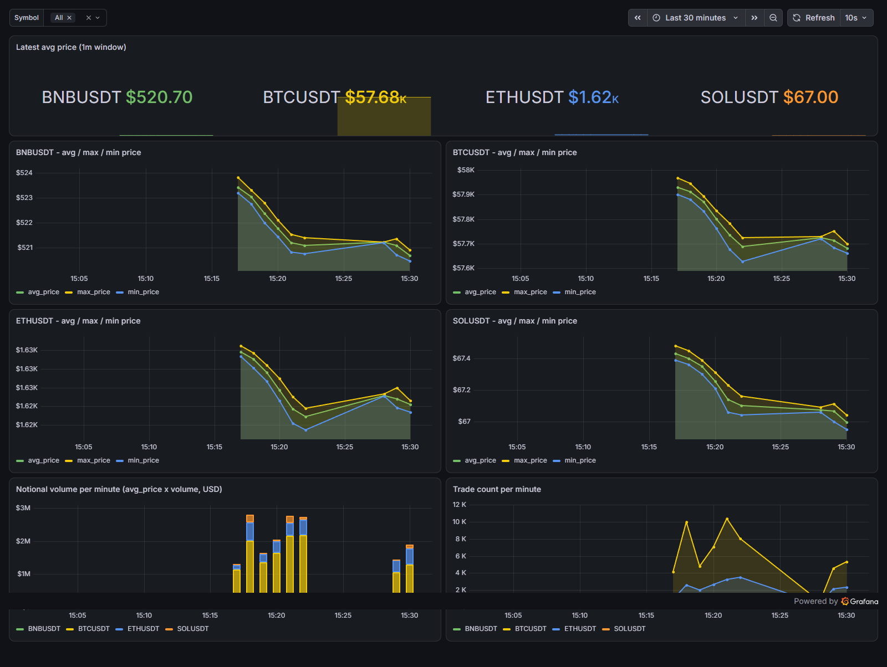
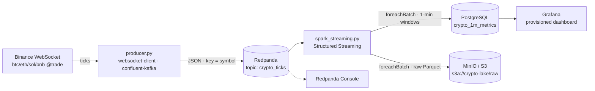
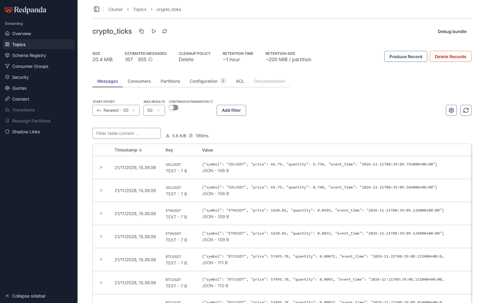
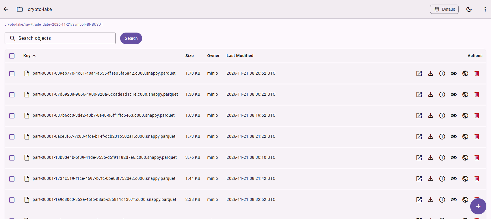

# Real-Time Crypto Streaming Pipeline


An end-to-end streaming pipeline that ingests **live trades from Binance**, publishes them to a **Kafka-compatible broker (Redpanda)**, and processes them with **PySpark Structured Streaming**. The job writes to two sinks at the same time:

- **Serving layer:** 1-minute OHLC-style aggregates go to **PostgreSQL** and are shown in **Grafana**.
- **Data lake:** raw ticks are stored as partitioned **Parquet** on **MinIO (S3)**.



---

## Architecture



| Stage | Component | What it does |
|---|---|---|
| Ingest | `src/producer.py` | Opens one combined WebSocket connection to 4 Binance `@trade` streams. Each trade is normalised to `{symbol, price, quantity, event_time}` and published to Kafka, keyed by symbol. |
| Transport | Redpanda | Kafka-API-compatible broker. The topic has 3 partitions and a retention of 1 hour or about 200 MiB per partition. |
| Process | `src/spark_streaming.py` | Parses JSON, applies a **10-second watermark**, and runs a **1-minute tumbling window** per symbol. |
| Serve | PostgreSQL + Grafana | Stores `avg / max / min price`, `total_volume` and `trade_count` per window. A Grafana dashboard is provisioned as code. |
| Store | MinIO (S3) | Stores the raw ticks as Snappy Parquet, partitioned by `trade_date` and `symbol`. |

---

## Key engineering features

- **Resilient producer.**
  - Reconnects automatically with exponential backoff (1 s to 60 s) and resets the backoff once a connection has stayed stable.
  - Sends WebSocket ping/pong heartbeats so that silently dead connections are detected.
  - Shuts down cleanly on `SIGINT`/`SIGTERM` and flushes pending messages first.
- **Ordered per symbol.** Messages are keyed by `symbol`, so all trades for one pair land in the same partition and stay in order.
- **Event-time processing.** Windows are based on the exchange's event timestamp, not on arrival time. A watermark bounds the streaming state and handles late data.
- **Dual sink through `foreachBatch`.** Two independent streaming queries run off one source. Each query has its own checkpoint stored on S3.
- **Lake-friendly layout.** Parquet files are partitioned by `trade_date` and `symbol`, so downstream batch jobs can skip irrelevant files when they filter on those columns.
- **Infrastructure as code.**
  - One `docker compose up` brings up the whole stack.
  - All image versions are pinned for reproducible builds.
  - The database schema, S3 bucket, Grafana datasource and dashboard are created or provisioned automatically.
- **Bounded demo runs.** The producer stops itself after a configurable runtime (`MAX_RUNTIME_MINUTES`) or message count (`MAX_MESSAGES`).

---

## Tech stack

| Layer | Technology |
|---|---|
| Language | Python 3.11 |
| Stream processing | Apache Spark 3.5 (PySpark Structured Streaming) |
| Message broker | Redpanda v26 (Kafka API) + Redpanda Console |
| Serving database | PostgreSQL 16 |
| Data lake | MinIO (S3-compatible), Parquet + Snappy |
| Visualisation | Grafana 13 (provisioned datasource + dashboard) |
| Orchestration | Docker Compose |
| Clients | `websocket-client`, `confluent-kafka`, `hadoop-aws` (s3a), PostgreSQL JDBC |

---

## Data model

**Kafka message** (`crypto_ticks`):

```json
{"symbol": "BTCUSDT", "price": 57931.53, "quantity": 0.00165, "event_time": "2026-11-21T08:17:42.104000+00:00"}
```

**PostgreSQL table** `crypto_1m_metrics` ([`sql/init.sql`](sql/init.sql)):

| Column | Type | Description |
|---|---|---|
| `symbol` | TEXT | Trading pair, e.g. `BTCUSDT` |
| `window_start` / `window_end` | TIMESTAMPTZ | Bounds of the 1-minute window (UTC) |
| `avg_price`, `max_price`, `min_price` | DOUBLE PRECISION | Price statistics within the window |
| `total_volume` | DOUBLE PRECISION | Sum of traded base-asset quantity |
| `trade_count` | BIGINT | Number of trades in the window |

**Data lake layout**:

```
s3a://crypto-lake/
├── raw/trade_date=2026-11-21/symbol=BTCUSDT/part-*.snappy.parquet
└── checkpoints/{metrics,raw}/          # Structured Streaming checkpoints
```

---

## Project structure

```
realtime-crypto-streaming/
├── src/
│   ├── producer.py              # Binance WebSocket -> Redpanda
│   └── spark_streaming.py       # Redpanda -> 1-min aggregates (PostgreSQL) + raw Parquet (MinIO)
├── sql/
│   └── init.sql                 # Table + index, auto-applied on first Postgres start
├── grafana/
│   ├── provisioning/            # Datasource + dashboard provider (as code)
│   └── dashboards/crypto.json   # Dashboard definition
├── scripts/
│   ├── screenshot_dashboard.py  # Re-capture docs/grafana-dashboard.png
│   └── screenshot_evidence.py   # Re-capture Redpanda & MinIO evidence
├── docs/                        # Screenshots used in this README
├── docker-compose.yaml          # Redpanda, Console, PostgreSQL, MinIO, S3 UI, Grafana
├── requirements.txt
├── requirements-dev.txt
└── .env.example
```

---

## Getting started

### Prerequisites

- Docker Desktop (or Docker Engine + Compose v2)
- Python 3.11+
- Java 8, 11 or 17 (required by Spark)
- **Windows only:** `winutils.exe` and `hadoop.dll` (Hadoop 3.3.x) in `%USERPROFILE%\hadoop\bin`. The Spark job detects this folder and sets `HADOOP_HOME` automatically.

### 1. Start the infrastructure

```bash
cp .env.example .env
docker compose up -d
```

### 2. Install Python dependencies

```bash
python -m venv .venv
# Linux/macOS: source .venv/bin/activate   |   Windows: .venv\Scripts\activate
pip install -r requirements.txt
```

### 3. Run the pipeline (two terminals)

```bash
python src/producer.py         # streams live trades into Redpanda
python src/spark_streaming.py  # aggregates + writes to PostgreSQL and MinIO
```

> The first Spark run downloads the Kafka, JDBC and S3A connector JARs (~300 MB).
> Aggregated rows appear about 70 seconds after a window closes. In append mode a window is emitted only once the watermark passes its end.

### Service endpoints

| Service | URL | Credentials |
|---|---|---|
| Grafana | http://localhost:3000 | `admin` / `admin` |
| Redpanda Console | http://localhost:8080 | — |
| S3 browser (MinIO) | http://localhost:8081 | — |
| MinIO S3 API | http://localhost:9000 | `minioadmin` / `minioadmin` |
| Kafka broker | `localhost:9092` | — |
| PostgreSQL | `localhost:5432` | `crypto` / `crypto` |

> These credentials are local development defaults. Change them in `.env` before exposing any service beyond localhost.

### Quick checks

```bash
# Messages in the topic
docker compose exec redpanda rpk topic consume crypto_ticks -n 5

# Latest aggregates
docker compose exec postgres psql -U crypto -d crypto \
  -c "SELECT * FROM crypto_1m_metrics ORDER BY window_start DESC LIMIT 8;"
```

---

## Results

**Live JSON ticks in Redpanda.** The topic configuration shows the 1-hour / 200 MiB retention policy.



**Parquet files in the data lake.** These are written by the raw sink of the PySpark job.



---

## Configuration

All settings are read from environment variables (see [`.env.example`](.env.example)):

| Variable | Default | Purpose |
|---|---|---|
| `KAFKA_BROKER` | `localhost:9092` | Kafka bootstrap server |
| `KAFKA_TOPIC` | `crypto_ticks` | Topic for raw ticks |
| `SYMBOLS` | `btcusdt,ethusdt,solusdt,bnbusdt` | Binance pairs to subscribe to |
| `WS_BASE` | `wss://data-stream.binance.vision` | Binance market-data WebSocket base URL |
| `MAX_RUNTIME_MINUTES` | `15` | Auto-stop the producer after N minutes (`0` = unlimited) |
| `MAX_MESSAGES` | `0` | Auto-stop the producer after N messages (`0` = unlimited) |
| `STARTING_OFFSETS` | `latest` | Kafka offsets used when Spark starts with no checkpoint |
| `S3_BUCKET` | `crypto-lake` | Bucket used for raw data and checkpoints |

---

## Design notes

- **Why Redpanda?** It is Kafka-API compatible, runs as a single binary, and needs no ZooKeeper or JVM. This makes it a good fit for a laptop-scale stack, and the producer and Spark connector can talk to it unchanged.
- **Why `data-stream.binance.vision`?** It is Binance's official public market-data endpoint on port 443. Port 9443 on `stream.binance.com` is often blocked on restricted networks.
- **Why append mode?** Each window is written exactly once, after it is finalised. Update mode would rewrite partial windows into an append-only JDBC sink.
- **Delivery semantics.** The JDBC sink is at-least-once: a retried micro-batch can insert duplicate rows. A unique key on `(symbol, window_start)` combined with an upsert would make it idempotent (see the roadmap).

## Roadmap

- [ ] Idempotent upserts into PostgreSQL (`ON CONFLICT (symbol, window_start)`)
- [ ] Run Spark as a container in Compose (removes the local Java/winutils requirement)
- [ ] Data-quality checks and a dead-letter topic for malformed messages
- [ ] Delta Lake or Apache Iceberg tables on MinIO for ACID guarantees on the lake
- [ ] Alerting rules in Grafana (e.g. price moves of more than X % per minute)

## License

Released under the [MIT License](LICENSE).
